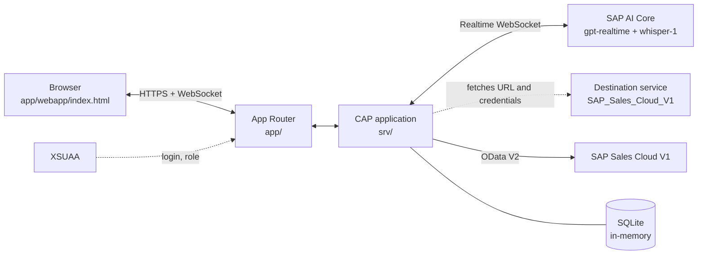
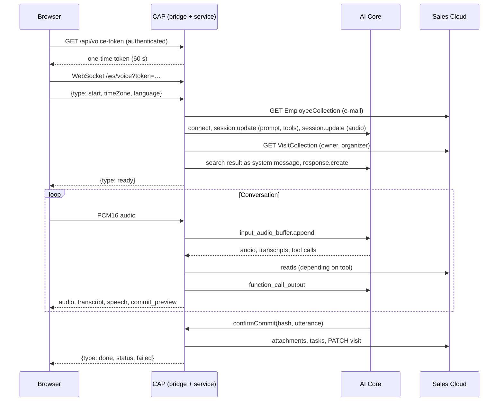
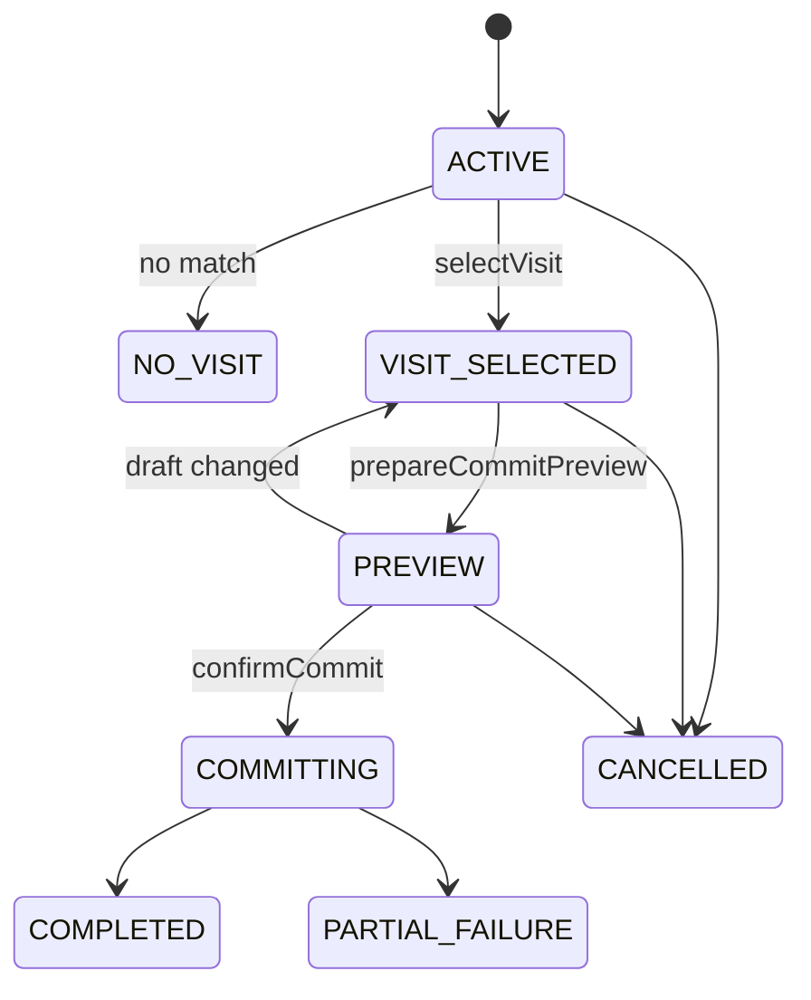

# AI-assisted Visit Documentation – Developer Documentation and Implementation Plan

As of 2026-11-26. The implementation plan in chapter 10 was reconstructed **after the fact** from code, tests and Git history.

This file is the entry point for developers who are new to the project. The code is always authoritative. See also:

| Document | Content | Note |
|---|---|---|
| [HANDOVER.md](HANDOVER.md) | Decisions and confirmed C4C mapping (German) | As of 2026-11-25, partly outdated |
| [open-security-risks.md](open-security-risks.md) | Accepted risks and open privacy questions | See chapter 9 for deviations |
| [c4c-metadata/](c4c-metadata/) | Confirmed `$metadata` excerpts and sample data | Source for all C4C fields and codes |

## Contents

1. [Functional overview](#1-functional-overview)
2. [Architecture](#2-architecture)
3. [Project structure](#3-project-structure)
4. [Runtime flow](#4-runtime-flow)
5. [Business logic and data model](#5-business-logic-and-data-model)
6. [Interfaces](#6-interfaces)
7. [Frontend](#7-frontend)
8. [Development, testing, deployment](#8-development-testing-deployment)
9. [Known limitations and open items](#9-known-limitations-and-open-items)
10. [Implementation plan (retrospective)](#10-implementation-plan-retrospective)

---

## 1. Functional overview

### Purpose

After a customer meeting, field sales staff document an **existing** visit in SAP Sales Cloud V1 (C4C) through a speech-to-speech conversation and create follow-up tasks. The solution is a side-by-side extension on SAP BTP.

### Binding rules

These rules are design constraints and must not be weakened:

- **No new visits** are ever created. A visit is never guessed.
- **Nothing is written to C4C without confirmation** by the user.
- **The AI never accesses C4C directly.** There is no generic "execute OData" tool.
- No secrets in the frontend or in the repository.
- **Never guess C4C details** (entity sets, fields, codes, payloads). Only use values verified against the tenant.
- Out of scope: new visits, opportunities, leads, sales orders, form-heavy UI.

### Business flow

1. The user opens the app and starts the conversation.
2. The app looks up the user's open visits for today and greets the user with the result.
3. The user confirms or picks the visit.
4. The user describes what was discussed.
5. Follow-up tasks are captured (subject, description, due date, assignee).
6. The end time is asked **only at the very end** (fallback: planned end).
7. The preview appears on screen. The AI names only the key facts, offers to read the summary, and asks separately for permission to save.
8. After confirmation the data is saved. The user can then document another visit.

### Result in SAP Sales Cloud

- PDF "Besuchszusammenfassung.pdf" (visit summary) attached to the visit
- PDF "Transkript KI-Besuchsdokumentation.pdf" (transcript) attached to the visit
- For each follow-up task: the task, an optional description text and a link to the visit
- On the visit: actual end time and status "Completed"

The PDFs, the UI and the conversation are in German.

### Conversation rules (AI behaviour)

Defined in [ai-tools.js](../srv/lib/ai-tools.js) (`SYSTEM_PROMPT`, written in German):

- Informal address ("du"), German by default (English possible), short answers, one question at a time
- Do not repeat what the user said; do not announce tool calls
- Say "Kunde" (customer), never "Account"
- German date format; speak times naturally
- **No** spoken privacy notice (deliberate decision of 2026-11-25, see P1)

---

## 2. Architecture



| Component | Responsibility |
|---|---|
| Browser | Microphone, playback, transcript, preview. Calls **no** tools. |
| App Router | Serves the static UI, forwards `/api` and `/ws/voice` to CAP |
| CAP application | Voice bridge, tool service, rules, C4C access, PDF generation |
| SAP AI Core | Realtime model (speech and tool calls), transcription |
| Destination service | Only provides the connection settings. Data does **not** flow through it. |
| SAP Sales Cloud | System of record. No master data is replicated. |
| SQLite | Session state only (draft, transcript, confirmation, operations, audit) |

### Layers inside CAP

```
voice-bridge.js     Transport and conversation control (browser <-> AI Core)
      |  in-process, on behalf of the logged-in user
voice-service.js    Business logic and validation (the AI's "tools")
      |
lib/c4c-client.js   The only place that knows C4C entity sets and fields
```

**Core principle:** AI output is untrusted. Everything read from or validated against C4C is set by CAP only.

---

## 3. Project structure

| Path | Content |
|---|---|
| [srv/server.js](../srv/server.js) | CAP bootstrap: `GET /api/voice-token`, attaches the voice bridge |
| [srv/voice-bridge.js](../srv/voice-bridge.js) | WebSocket bridge, AI Core session, tool dispatch, multi-visit logic |
| [srv/voice-service.cds](../srv/voice-service.cds) | Tool surface `VoiceAssistantService` |
| [srv/voice-service.js](../srv/voice-service.js) | Tool implementation and commit |
| [srv/lib/ai-tools.js](../srv/lib/ai-tools.js) | System prompt and tool definitions for the model |
| [srv/lib/c4c-client.js](../srv/lib/c4c-client.js) | All C4C reads and writes |
| [srv/lib/c4c-codes.js](../srv/lib/c4c-codes.js) | Entity sets and verified code values |
| [srv/lib/pdf-generator.js](../srv/lib/pdf-generator.js) | Summary and transcript PDF (`pdf-lib`) |
| [srv/lib/time.js](../srv/lib/time.js) | Time zones, OData dates, German formats, `spokenTime` |
| [srv/lib/validation.js](../srv/lib/validation.js) | Time zone and language checks |
| [srv/lib/tool-result.js](../srv/lib/tool-result.js) | Uniform result format of the tools |
| [db/schema.cds](../db/schema.cds) | Data model |
| [app/webapp/index.html](../app/webapp/index.html) | Complete UI (HTML, CSS, JavaScript) |
| `app/webapp/ui5.bundle.js` | **Generated** and committed. Do not edit by hand. |
| [app/xs-app.json](../app/xs-app.json) | App Router routes |
| `ui-src/` | Sources of the UI5 bundle |
| `test/` | Tests and C4C mock |
| `spikes/aicore-realtime/` | Early proof of concept for AI Core Realtime |
| [mta.yaml](../mta.yaml), [xs-security.json](../xs-security.json) | Deployment and roles |

Technology: Node.js with ESM, SAP CAP (`@sap/cds` 10), `ws`, `@sap-ai-sdk/openai`, `pdf-lib`, UI5 Web Components 2.29.0.

---

## 4. Runtime flow

### 4.1 Connection setup and conversation



### 4.2 Bridge details

These points were added after failures in live operation. Keep them in mind when changing the code:

| Topic | Solution |
|---|---|
| Audio before the session is ready | Dropped (`audioReady`), otherwise "could not send data" |
| Only one active response allowed | `responseActive`, `responsePending`, `openToolCalls` and `requestResponse()`; never send `response.create` directly |
| Initialisation | Two `session.update` calls: first text with instructions and tools, then audio |
| Greeting | `findVisit` runs **before** the first answer |
| Turn taking | `server_vad` with `silence_duration_ms` 1400 (configurable: `cds.voice.aicore.silenceDurationMs`), `interrupt_response: true` |
| No barge-in | The browser sends silence while the answer is audible (plus 0.3 s) |
| Idle during pause | WebSocket ping every 25 s |
| Another visit | `startNextVisit` (bridge only): new AI client and new CAP session; handlers of the old client ignore events (`client !== aiClient`) |
| Development without AI Core | With mocked auth the session stays open without voice AI |

### 4.3 Message protocol browser ⇄ CAP

Binary frames in both directions are PCM16, mono, 24 kHz.

| Direction | `type` | Content |
|---|---|---|
| Browser → CAP | `start` | `timeZone`, `language` |
| Browser → CAP | `stop` | – |
| CAP → Browser | `ready` | `sessionId` |
| CAP → Browser | `transcript` | `role`, `text` |
| CAP → Browser | `speech` | `active` (user is speaking or has stopped) |
| CAP → Browser | `commit_preview` | `previewHash`, `previewText` |
| CAP → Browser | `done` | `status`, `code`, `failed[]` |
| CAP → Browser | `new_visit` | UI clears transcript and preview |
| CAP → Browser | `error` | `code`, `message` |
| CAP → Browser | `stopped` | – |

---

## 5. Business logic and data model

### 5.1 AI tools

All tools return `ToolResult { ok, code, message, data }`; `data` is a JSON string. `message` is a hint **for the AI**, not text for the user. The AI never sees the `sessionId`; the bridge adds it.

| Tool | Purpose | Key checks |
|---|---|---|
| `startSession` (bridge only) | Create the session | Login e-mail matches exactly one active employee |
| `cancelSession` (bridge only) | Discard the session | Not while committing |
| `findVisit` | Find today's visits | Owner or organizer, status Open, starts today |
| `selectVisit` | Fix the visit | Only candidates from `findVisit`; re-read from C4C and re-checked |
| `getVisitContext` | Look up details | Visit selected |
| `resolveEmployee` | Check a name | Active employees; ask if there are several |
| `updateVisitDraft` | Summary, end time | `HH:mm`, not in the future |
| `addTaskDraft`, `updateTaskDraft`, `removeTaskDraft` | Follow-up tasks | Subject required, `dueTime` only with `dueDate`, processor resolved |
| `prepareCommitPreview` | Preview and hash | Summary and end time present, all processors valid |
| `confirmCommit` | Save | Status `PREVIEW`, valid hash, consent in the utterance |
| `startNextVisit` (bridge only) | Next visit | Only after a saved visit |

A new tool needs: an action in `voice-service.cds`, a handler in `voice-service.js`, a definition in `AI_TOOLS`, and if necessary changes to the prompt and to `phase6-bridge.test.js`.

### 5.2 Session status



`COMPLETED`, `PARTIAL_FAILURE`, `FAILED`, `CANCELLED` and `NO_VISIT` are final states. `FAILED` exists in the model but is currently never set.

### 5.3 Confirmation and commit

- **Preview hash:** SHA-256 over the frozen draft. Every change increments the version and sets open confirmations to `SUPERSEDED`.
- **Consent check:** the utterance must contain a word from `YES_WORDS` and none from `NO_WORDS`; any refusal word wins. The utterance is the one **the AI** passes as `userUtterance` (see chapter 9).
- **Order in `runCommit`:** summary PDF, transcript PDF, per task (create, text, link), end time, status.
- **Error handling:** every step is logged separately (`CommitOperations`). A failure does not stop the following steps. Only text and link are skipped if the task was not created.
- **Idempotency:** a unique `idempotencyKey` per operation; successful operations are not executed again.

### 5.4 Detailed business rules

| Topic | Rule |
|---|---|
| "Today" | Calendar day in the device's time zone |
| Active employee | Employee and user validity include today, user not locked |
| Task owner / processor | Owner = logged-in user; processor = named person, otherwise the user |
| Due date | Local time, converted to UTC; 17:00 if no time is given; start = due minus 1 hour (C4C requires start before end) |
| Priority / type | `3` / `DocumentType 0006` |
| PDF character set | Helvetica (WinAnsi); characters it cannot encode become `?` |

### 5.5 Data model

Naming convention in [db/schema.cds](../db/schema.cds): `c4c*` = read from or validated against C4C, `proposed*` = proposed by the AI.

| Entity | Content |
|---|---|
| `VoiceSessions` | Session, user, time zone, status, visit candidates, expiry date |
| `VisitDrafts` | Selected visit, summary, end time, version |
| `TaskDrafts` | Follow-up tasks with resolved processor |
| `TranscriptEntries` | Conversation text per turn |
| `CommitConfirmations` | Preview, hash, confirmation |
| `CommitOperations` | Individual C4C write steps with status and error |
| `AuditLog` | Metadata only, no conversation content |

The database is SQLite **in-memory**: it is empty after every restart. Audio is not stored.

---

## 6. Interfaces

### 6.1 HTTP and WebSocket

| Endpoint | Protection |
|---|---|
| `GET /api/voice-token` | XSUAA or mocked auth, role `VisitDocumenter` (scope) |
| `/ws/voice?token=<uuid>` | One-time token, valid for 60 s (held in process memory) |

`VoiceAssistantService` is declared with `@protocol: 'none'` and is **not** reachable over HTTP.

### 6.2 SAP Sales Cloud (OData V2)

Configured in [package.json](../package.json) under `cds.requires.c4c`: destination `SAP_Sales_Cloud_V1` (BasicAuthentication, technical user), path `/sap/c4c/odata/v1/c4codataapi`, CSRF enabled. The technical user can see more than the logged-in user, so CAP enforces authorisation itself.

| Call | Purpose |
|---|---|
| `GET EmployeeCollection` | User by e-mail, assignees by name |
| `GET VisitCollection` (twice) | Open visits as owner and as organizer |
| `GET VisitCollection('ID')` | Single visit with ETag |
| `POST VisitCollection('ID')/VisitAttachment` | Attach PDF; on 404 fall back to `VisitAttachmentCollection` |
| `POST TasksCollection` | Create task |
| `POST TasksTextCollection` | Description; on error fall back to `TasksCollection('ID')/TasksTextCollection` |
| `POST TasksBTDReferenceCollection` | Link (`ID` = **Visit.ID**, not ObjectID) |
| `PATCH VisitCollection('ID')` | End time, then status |

Tenant specifics:

- `$filter` with `or` across different properties is rejected, hence two queries.
- Date comparisons in `$filter` are rejected, hence CAP filters by day.
- `PATCH` needs `If-Match`; the ETag is re-read right before writing, with one retry on 412.
- C4C may reject the status "Completed" if mandatory tasks or surveys on the visit are open.
- The C4C error message is passed through to the UI.

In tests, `setTransport()` in `c4c-client.js` replaces the HTTP transport.

### 6.3 SAP AI Core

Configured under `cds.voice` in `package.json`:

| Key | Value |
|---|---|
| `aicore.realtimeModel` | `gpt-realtime` |
| `aicore.transcriptionModel` | `whisper-1` |
| `aicore.resourceGroup` | `default` (the bridge does not currently pass this value to the SDK explicitly) |
| `aicore.silenceDurationMs` | optional, default 1400 |
| `sessionRetentionDays` | 7 |

---

## 7. Frontend

Everything is in [app/webapp/index.html](../app/webapp/index.html). Apart from the component bundle there is no build step.

- **Components:** SAP UI5 Web Components (Horizon light and dark), bundled locally, no CDN.
- **Voice halo:** WebGL fragment shader; states `idle`, `connecting`, `listening`, `thinking`, `speaking`, `error`; CSS fallback without WebGL.
- **Status display:** `setStatusState()` is the only place that sets state and texts.
- **Audio:** two separate `AudioContext`s: `audioCtx` (playback) and `micCtx` (capture). Capture uses `ScriptProcessorNode` (deprecated, but needs no extra worklet file).
- **Pause:** capture is torn down and rebuilt on resume, playback is only suspended. WebSocket and AI session stay open.
- **Development login:** on a 401 the fields for user name and password appear.

Rebuild the bundle (only when components, icons or themes change):

```bash
npm install
npm run build:ui   # ui-src/ui5.js -> app/webapp/ui5.bundle.js
```

---

## 8. Development, testing, deployment

### 8.1 Setup

```bash
npm install
npm install --prefix app
```

| Start | Auth | C4C / AI Core | Use |
|---|---|---|---|
| `cds watch` | mocked | no bindings | UI and connection setup; no visit search without C4C |
| `cds watch --profile hybrid` | mocked | real bindings | End-to-end test |
| Cloud Foundry | XSUAA | real bindings | Target operation |

For `hybrid`, create the bindings for Destination and AI Core with `cds bind`; they are stored in `.cdsrc-private.json` (**do not commit**). For the visit search to return results, the mock user's e-mail must match an active employee in the tenant (also override it in `.cdsrc-private.json`).

Mock users: `alice` and `carol` with the role, `bob` without it (password equals user name). In case the SAP BAS tunnel strips the `Authorization` header, `server.js` has the development fallback `?_dev_user=`; it only works with mocked auth outside production.

### 8.2 Tests

```bash
npm test   # node --test --test-concurrency=1
```

| File | Subject |
|---|---|
| `phase1-foundation` | Data model, service, authorisation |
| `phase2-c4c-read` | Visit and employee search |
| `phase3-draft` | Draft and preview |
| `phase4-tasks` | Follow-up tasks |
| `phase5-commit` | Writing to C4C, idempotency, refused confirmations |
| `phase6-bridge` | Tool definitions, prompt, token |
| `voice-token` | Login and role check of the token endpoint |
| `pdf-generator` | Multi-page PDFs, special characters |
| `task-period` | Time zone conversion of due dates |

C4C is replaced by `test/mocks/c4c-mock.js`. The bridge together with AI Core, and the UI, have **no automated tests**; they are verified in conversation.

### 8.3 Deployment (not yet performed)

```bash
mbt build
cf deploy mta_archives/aiAssistedVisitDocumentation_1.0.0.mtar
```

Prerequisites: entitlements for XSUAA (`application`) and Destination (`lite`), an existing AI Core instance named `aicore`, destination `SAP_Sales_Cloud_V1`. The e-mail of the login must match exactly one active employee in C4C. Deploy into the space that contains the AI Core instance. Afterwards assign the role collection `Z_VisitDocumenter`. Because of the in-memory database and token store, only **one instance** is possible.

**Before the first build:** run `npm install` and commit the updated `package-lock.json`; `mbt build` uses `npm ci` and fails on an outdated lock file.

`mta.yaml` sets `NODE_ENV=production` for the server and registers the XSUAA redirect URIs for the landscape domain. The App Router requires a login for the UI and `/api`; `/ws/voice` is protected by the one-time token. Not yet verified in a real deployment: startup with in-memory SQLite in production, and the e-mail attribute of the XSUAA user.

### 8.4 Ways of working

- Do not use C4C fields or codes without evidence; store new evidence in `docs/c4c-metadata/`.
- Tests are run in SAP BAS.
- No credentials and no personal test data in the repository.

### 8.5 Troubleshooting

| Symptom | Possible cause |
|---|---|
| `USER_NOT_IN_C4C` | Login e-mail matches no active employee, or several |
| `NO_VISIT` | No open visit today as owner/organizer; also see the limit of 50 in chapter 9 |
| 401 on the token endpoint | Development login needed |
| `AICORE_UNAVAILABLE` / `AICORE_TIMEOUT` | Binding or model deployment missing |
| "active response in progress" | `response.create` sent bypassing `requestResponse()` |
| Attachment or text fails | Authorisation of the technical user; log category `c4c` |
| Status "Completed" fails | Open mandatory tasks or surveys on the visit |

Log categories: `voice`, `voice-bridge`, `c4c`, `server`.

---

## 9. Known limitations and open items

Result of a code review on 2026-11-26. These points are **not yet fixed**. (The consent check found in the same review has since been corrected.)

### Priority

1. **The checked utterance comes from the AI**, not from the stored transcript.
2. **Status "Completed" is set even after partial failures.** The visit can be completed although attachments or tasks are missing.
3. **No retry after partial failures.** `PARTIAL_FAILURE` is a final state, so idempotency currently does not help the user.

### Privacy and operations

4. **No deletion.** `open-security-risks.md` (P1) describes deletion after commit or after 7 days. The code does not implement this; expired sessions are only blocked.
5. **No duplicate check in C4C.** R2 describes such a check as mitigation; it does not exist. `SKIPPED_EXISTING` is never set.
6. R1: the destination allows `HTML5.DynamicDestination`.
7. R2: in-memory SQLite, one instance, audit log not durable.
8. No privacy notice and no consent step; approval is pending.

### Functional

9. **Visit search is limited:** at most 50 open visits per query, and the day filter is applied afterwards. With many old open visits, today's visit can be missed.
10. The employee search returns at most 20 hits and only exact names.
11. The end time is not checked against the start time.
12. Pause and draft do not survive a page reload.

---

## 10. Implementation plan (retrospective)

Period according to Git history: 2026-11-16 to 2026-11-26.

### Phases

| Phase | Goal | Main results | Evidence |
|---|---|---|---|
| 0 – Feasibility | Check AI Core Realtime | Spike: audio, tool calls, VAD, transcription | `spikes/aicore-realtime/` |
| 1 – Foundation | Project and data model | CAP project, schema, tool surface, roles, mock users | `phase1-foundation` |
| 2 – Read C4C | Identify person and visit safely | `c4c-client`, `startSession`, `findVisit`, `selectVisit` | `phase2-c4c-read` |
| 3 – Draft | Capture and confirm content | `updateVisitDraft`, `prepareCommitPreview`, preview hash | `phase3-draft` |
| 4 – Follow-up tasks | Tasks with assignees | Task tools, processor resolution | `phase4-tasks` |
| 5 – Commit | Write to C4C | `confirmCommit`, `runCommit`, PDFs, idempotency | `phase5-commit` |
| 6 – Voice bridge | Connect speech | WebSocket bridge, one-time token, system prompt | `phase6-bridge` |
| 7 – User interface | Usable UI | First browser UI, development fallbacks | manual |
| 9 – Deployment | Make it BTP-ready | App Router, XSUAA, Destination, `mta.yaml` | not yet deployed |

A separate phase 8 cannot be identified from the history or the documents.

### Stabilisation and extension (2026-11-25 to 2026-11-26)

| Package | Content |
|---|---|
| Live operation | Fixes for authorisation, destination, AI context, prompt and saving |
| UI | Voice halo, move to SAP Fiori / Horizon, light and dark |
| Robustness | Response queue, audio only once ready, precise error messages |
| Documents | Multi-page transcript, German formats |
| Conversation | Less repetition, fluent greeting, end time at the end, natural times |
| Features | Pause, multiple visits, due time |
| Turn taking | Neither the assistant nor the user should be interrupted |

### Recommended next steps

| No. | Step | Relates to (chapter 9) | Done when |
|---|---|---|---|
| 1 | Define handling of partial failures (status, retry) | 2, 3 | Decision made and tested |
| 2 | Run tests in BAS and verify conversations end to end | – | Tests green, test log available |
| 3 | Deletion concept and privacy approval | 4, 8 | Approval received, deletion tested |
| 4 | Persistent database, dedicated destination | 6, 7 | Configuration switched |
| 5 | Make the visit search reliable | 9 | Today's visit is found even with a large backlog |
| 6 | Deploy to BTP, verify login, voice connection and dev fallback | 8.3 | App runs with XSUAA, fallback not usable |

### Open functional assumptions

Not yet confirmed: `DocumentType 0006` as the standard task type, the user as default processor, no tasks for employees without a valid user.
